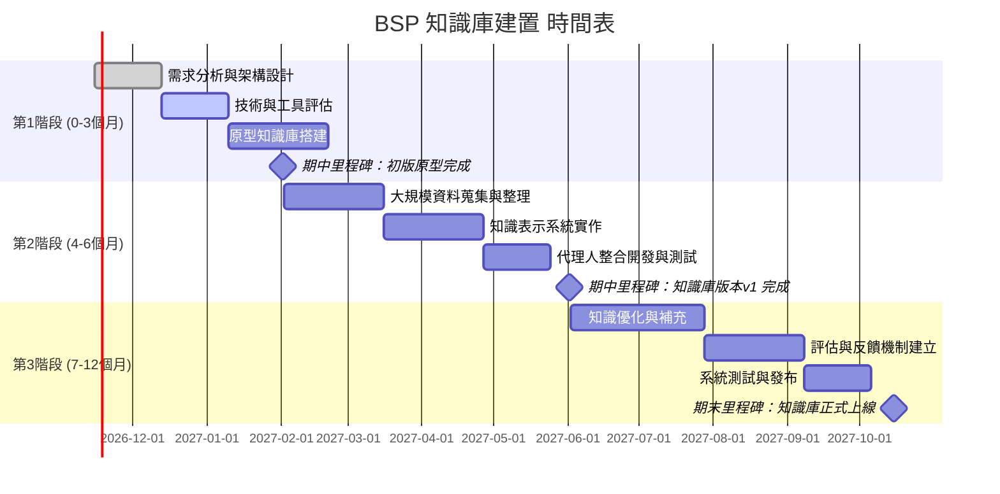

# 執行摘要  
本報告針對「板級支持包（BSP）」知識庫的蒐集與建置策略進行深入分析，聚焦於同一知識庫能同時服務人類學習教材與AI代理人能力擴充之需求。首先，界定BSP的範疇並探討至少五種典型應用情境，如智慧手機、工業控制、車用電子、醫療裝置、物聯網設備等，並說明各情境下所需的相關知識（如硬體架構、作業系統移植、驅動開發、系統初始化等）。接著，提出資料來源的優先順序與範例，包括：官方技術文檔（例如SoC廠商的BSP手冊、作業系統文件）、行業標準（如ISO 26262功能安全標準）、學術論文、社群資源（技術論壇、開源專案）與實務案例等；強調以中文資源為優先，同時兼顧重要英文原始來源。  

報告再說明知識蒐集的方法與工具，例如爬蟲（Scrapy、BeautifulSoup）、API介接（廠商SDK、開源接口）、人工彙整（文獻整理）、OCR文字辨識（Tesseract）、語音轉文字（Google Speech、Whisper）等，並建議對蒐集到的知識進行元資料標註（來源、版本、可信度、授權條款）以確保可追蹤性與品質控管。在知識表示與結構方面，比較了不同形式的存儲與組織方式：如文件庫（普通檔案或Wiki）、向量資料庫（用於語意檢索）、知識圖譜（結構化實體關係）、FAQ問答系統、教學模組等；並以表格呈現各自的優缺點，例如向量庫對檢索大規模非結構化文本效果佳但解釋性差、知識圖譜可提供高度可解釋的關聯查詢但維護成本高等。  

接著，討論同一知識庫同時滿足人類教材與AI代理兩種用例時的設計原則，包括：**可檢索性**（需有良好的索引與搜尋機制）、**可解釋性**（內容需有明確來源與註釋，方便人機理解）、**可測試性**（需可驗證更新與功能，如同軟體測試流程）、**授權與隱私**（需遵守版權、隱私法規）、**延展性**（可模組化擴充新內容）。並列舉具體作法範例，如以Markdown搭配知識庫平臺（共用程式庫）、使用語義搜索搭配明確引用，確保機器人回答可回溯源頭。  

版本管理與正向累積部分，建議將知識庫採用版本控制（如Git/GitHub）以及CI/CD流程自動化檢查（例如文件建置與連結檢查），結合人工審核和迴圈回饋機制，例如定期專家評審和使用者回饋。可應用指標如內容覆蓋率、回應正確率等來衡量累積成果。  

評估與驗證方面，提出人類學習效果指標（如學習後測試分數、使用者滿意度）、代理人能力測試（使用問答與任務執行情境）、A/B測試設計等。報告列出五個具體測試案例，如：學生學習某BSP教學模組前後測驗分數比對；AI代理人回答BSP配置問題的正確率評估；AB測試比較知識庫不同版本對使用者支援效果的差異等。  

最後，風險與法遵層面提醒注意：需確認引用資料版權及開放授權情況（避免侵權）、保護個人資料隱私（資料去識別化）、避免內容偏誤或錯誤傳播（專家審核並標示不確定性）。建議對敏感或法規相關內容做額外審核與紀錄，並建立緊急糾錯機制。  

報告末尾附上階段性實作時程規劃（3/6/12月為節點），以甘特圖或時程圖呈現各階段任務與里程碑，同時列出建議的工具與技術棧（開源與商業並重），以及各階段的交付物、主要負責角色與工時估算表格，作為專案執行參考。

## BSP範疇定義與使用情境  
**範疇定義**：BSP（Board Support Package）是嵌入式系統中連結硬體平台與作業系統的基礎層軟體。其主要作用是屏蔽底層硬體差異，提供**硬體抽象層**、**裝置驅動**、**啟動程式**等，使作業系統能在特定硬體上啟動並運行。例如Linux或Android要移植到新系統單晶片（SoC），就需要對應的BSP來提供CPU、記憶體、時鐘、中斷等初始設定。  

**典型使用情境與知識需求**：以下列舉五種具體情境及其所需知識：  
- **消費電子裝置**：如智慧手機、平板電腦、智能門鎖、掃地機器人等。這些裝置硬體高度客製化，需移植Linux/Android或RTOS，撰寫驅動程式（如顯示、GPIO、網路、BLE）、設定Bootloader和韌體。工程師需理解特定SoC架構、UART/USB/SPI等介面初始化，以及電源管理與性能調校。  
- **車用電子系統**：例如先進駕駛輔助系統（ADAS）或車載娛樂系統。此情境下BSP需支援車用Linux或QNX，並符合ISO 26262功能安全要求。知識需求包括安全啟動機制、實時中斷控制、雷達/攝影機驅動，以及冗餘系統與故障安全機制。  
- **工業控制系統**：如可編程邏輯控制器（PLC）、嵌入式控制器。需高速穩定的實時效能。BSP須整合工控總線（如Modbus、CAN）、感測器驅動及硬體抖動防護。相關知識包括RTOS移植、記憶體和時鐘設定，以及硬體隔離與EMI防護。  
- **醫療/生命科技裝置**：如監測儀器、植入式裝置。要求極高可靠度與認證。BSP實現必須紀錄完整軟硬體來源、版本，並支援安全的系統更新。需掌握法規要求、嚴格的驅動測試流程及故障診斷機制。  
- **物聯網（IoT）終端與智慧家居**：如智慧感測器、智能家庭網關。此類系統硬體資源受限，BSP需優化啟動時間、節能模式和網路協定（如LwM2M、CoAP）。知識需求包括低功耗MCU啟動流程、無線網路驅動、以及輕量級RTOS或協作處理器設定。  

以上情境均可從硬體定義、驅動程式撰寫、啟動參數配置等角度歸納知識需求。例如智慧手機BSP需要GPU、Camera驅動和電源管理；工業控制需Ethernet/IP或Profinet驅動；車用需CAN、雷達信號處理等。整體而言，BSP知識涵蓋「片上系統架構」、「啟動載入程式（Bootloader）實作」、「裝置樹(Device Tree)或啟動參數設定」、「作業系統內核配置與補丁」、「硬體初始化程式設計」等核心領域。  

## 資料來源優先順序與範例  
知識庫內容應以權威且相關性高的資料為主。建議的資料來源與優先順序如下：  
1. **官方技術文件與手冊**：包括SoC晶片廠商、主板廠商或作業系統（Linux、Android、RTOS等）的官方BSP文檔、技術手冊和設計指南。這類文件通常提供最準確的硬體描述、寄存器設定及軟體整合細節。例如ARM、NXP、高通等官方BSP開發指南，以及Linux kernel or Yocto項目的官方文件。  
2. **產業標準與法規**：涉及功能安全（ISO 26262）、醫療（IEC 62304）、通訊協定等標準文件，可為BSP設計提供合規與質量保證指引。參考國際或國內認證標準，確保知識庫內容符合法規要求。  
3. **學術論文與專業白皮書**：尋找嵌入式系統、作業系統移植、硬體架構等相關的最新研究論文或技術白皮書，可提供前沿技術與理論基礎。例如IEEE或ACM會議論文探討BSP設計模式、功耗優化、或Knowledge Graph在嵌入式系統的應用。  
4. **社群討論與開源專案**：技術社群論壇（如Stack Overflow、GitHub Issue、CSDN技術論壇）和BSP專案（如OpenEmbedded/Yocto、Buildroot）中的討論、分享和範例程式碼，可補充實戰經驗和常見問題的解決方案。例如CSDN上許多專家撰寫的BSP教學與開發經驗分享，或GitHub上的BSP樣板程式庫。  
5. **實務案例與培訓資料**：參考企業內部案例、實習教材、培訓講義或技術部落格（技術部、開源組織發佈的應用案例）。這類資料有助於整理出知識庫的教學模組或FAQ內容，並可附帶實際的程式範例。  

以上來源優先以**中文資源**為主，例如政府/企業發佈的繁體中文白皮書、台灣嵌入式協會技術文件等，但同時也須納入關鍵的**英文原始資料**（如英語官方手冊、原文論文），以確保資訊完整性與時效性。所有引用網頁資源均附上連結來源，以便檢視原文依據。  

## 知識蒐集方法與工具  
**自動化蒐集**：可以採用爬蟲工具（如Scrapy、BeautifulSoup）自動擷取公開網頁上的技術文檔和論壇帖子；使用API（廠商文檔API或開放資料接口）批次獲取資料；使用開源掃描工具（如GitHub Repository API）蒐集相關開源程式碼。對於需要電子化的紙本資料，可使用OCR技術（Tesseract）將掃描文件轉成文字；對於錄音或視訊教學內容，可用語音轉文字（如OpenAI Whisper、Google Speech-to-Text）提取講稿。  

**手動整理與審核**：由領域專家手工評讀重要資源，摘錄關鍵內容並撰寫摘要，確保資料準確且具體；同時可以使用Markdown等格式進行知識條目編撰，方便版本管理。所有蒐集到的內容應建立**元資料標註**：記錄來源URL或文件名、原版發布日期與版本號、可信度評分（例如由專家審核評分）、授權資訊（開放授權、版權狀態），以便追溯與法律合規。  

**工具建議**：  
- **爬蟲與解析**：Scrapy、Python Requests + BeautifulSoup；  
- **OCR**：Tesseract (開源)；  
- **語音轉文字**：OpenAI Whisper (開源)、Google Cloud Speech-to-Text (商業)；  
- **數據庫管理**：PostgreSQL/MongoDB (開源) 作為資料庫存儲原始和處理後數據；  
- **版本控制**：Git/GitHub或GitLab，用於跟踪知識條目版本；  
- **協作平台**：Markdown編輯器、Wiki系統 (如Docusaurus, MkDocs) 進行內容編纂，支援多人協作。  

## 知識表示格式與結構建議  
針對不同需求，可考慮下列知識表示方式並比較其優缺點：

| 表示方式           | 優點                                                                                                         | 缺點                                                                                              |
|--------------------|--------------------------------------------------------------------------------------------------------------|---------------------------------------------------------------------------------------------------|
| **文件庫（檔案系統或Wiki）**  | - 結構簡單，易於編寫和維護，可直接存放教程、白皮書、技術文檔； - 熟悉的格式（Markdown、PDF）易於閱讀； | - 搜尋能力主要靠關鍵字匹配，語意檢索能力弱； - 不利於結構化查詢與機器理解；                              |
| **向量資料庫**        | - 適合語意檢索，能在非結構化文本中找到相關片段； - 適用於RAG (檢索增強生成) 情境，可快速從大量文檔中提取上下文； | - 返回結果不可解釋； - 容易產生「上下文污染」，將無關內容混入回答； - 對資料的結構化支持弱；   |
| **知識圖譜/圖資料庫**   | - 資料以實體-關係方式結構化，查詢時可表達複雜關聯； - 提供高度**可解釋性**，可以精確過濾和推理； - 有助於語意擴展、同義詞查找等（“圖譜即專家”）； | - 構建和維護成本高，需要先定義本體與數據模式； - 查詢需撰寫SPARQL/Cypher等，學習曲線陡峭；         |
| **FAQ/問答庫**      | - 直接針對常見問題提供短答案，使用者易於查閱； - 適合做快速幫助和入門指引；                              | - 覆蓋範圍有限，遇到新問題無法應對； - 隱含簡化前提，不利於深度學習；                                       |
| **教學模組/課程**    | - 系統化組織知識，支持由淺入深學習； - 可包含練習、示例程式及評測，有助於人類學習成效提升；                  | - 編寫維護耗時、更新不易； - 不利於非線性快速檢索； - 機器人取用時難以直接抓取具體資訊段落。                |

在實踐中，可採用**多重結合**方式：例如將技術文檔和FAQ存於傳統文件庫；對重要概念或文檔進行向量化並存入向量DB以加強檢索；對核心領域知識（如BSP元件關係）構建知識圖譜來支援複雜查詢。同時維持一套教學模組或教程，供培訓和教育使用。  

## 同一知識庫服務人類與Agent的設計原則  
為兼顧**人類學習**與**AI代理人**兩種角色，知識庫設計應符合以下原則：  

- **可檢索性（Retrievability）**：需提供高效檢索能力。對人類而言，可實現全文搜索、目錄索引和關鍵字導航；對AI代理，可利用向量檢索或語義搜索工具（如Elasticsearch配合語句嵌入）快速定位答案段落。例如可將文檔切分成知識小塊，嵌入向量庫以供RAG檢索，並標註標題/段落以提高精準度。  
- **可解釋性（Interpretability）**：所有答案需保留來源標註和說明，以便人類理解並驗證，也方便代理人提供參考來源。對知識圖譜而言，實體與關係本身具語義，可直接解釋；向量檢索則應配合提示返回原文片段，並顯示來源連結。例如提供“此回答來自BSP文檔第5頁”之類的引用註記。  
- **可測試性（Testability）**：對人類教材，可設計評測題和練習題來檢驗學習成果；對代理人，可建立標準的問答測試集（類似QA benchmark）與交互場景，定期驗證知識庫更新後的效能。全程應有自動化測試或審核流程，例如內容Lint檢查、連結正確性檢查和質量審核，確保變更符合規範。  
- **授權與隱私**：知識庫中應明確標註內容授權，優先使用開放授權（如CC BY）或自有授權的資料。對包含個資或機密的內容，須事先去識別或限制存取，以符合法規（如GDPR類別法規）。實作範例：建立內容審批流程，對來源進行版權審查；對含私有資料段落加密存儲或隔離檢索管道。  
- **延展性**：系統需模組化設計，方便未來新增硬體平台或技術領域。採用標準格式（如Markdown、JSON-LD）與開放接口，使開發者能無縫擴充。實作範例：使用知識圖譜時新增節點與關係類型以拓展領域；向量庫定期追加新文檔並重新建立索引。  

具體實作上，設計人員可參考中的規範：如為不同知識源建立專門工具（Database工具、RAG工具、Graph工具）讓代理人對應調用；對人類則可以透過知識圖譜可視化工具和教程平台供學習。如一個範例，利用**LangChain**框架串聯文件庫與向量DB，並在答案中附上引用註記，實現人機共用的查詢系統。  

## 版本管理與正向累積機制  
知識庫應如軟體專案般進行版本管理。建議使用**Git**等版本控制系統（VCS）管理所有知識條目與教學模組，並結合CI/CD流程。每次更新可自動觸發：編譯檢查（確保文檔格式正確）、鏈接檢測、版權掃描（如檢查引用遵循原文授權）等。  

**審核與回饋**：除了技術檢查外，建立多階段審核流程：內容新增或更動需由BSP專家複審，並留存審核意見，確保資訊正確。使用者（工程師或學員）的反饋也應納入迴路，如建立討論平台或意見回報機制，定期收集意見並修正知識庫錯誤。  

**CI/CD 與工具建議**：可採用GitLab CI/GitHub Actions做自動化，如拉取新資料後自動進行文件生成、單元測試、語言檢查和安全審查。若資料量大，可使用ETL工具（如Apache Airflow）定時更新內容來源。對元資料可使用schema管理工具（如JSON Schema驗證）確保一致性。  

**評估指標**：設定量化指標以追踪累積效益，例如知識庫條目數、覆蓋的硬體平台數、用戶查詢成功率、代理回答正確率（F1分數）等。這些指標可隨時間記錄，評估版本更新後的成效。  

## 評估與驗證方法  
**人類學習評估**：可採用學習科學中的指標，如學習前後測試成績改變、教材完成率、使用者滿意度調查等。例如針對每個教學模組設計前測與後測題目，量化評估學習成效；或A/B測試不同教材版本對理解度的影響（例如群組A使用新版課程，群組B使用舊版，檢測知識掌握度差異）。  

**代理能力測試**：構建**測試用例集**，針對BSP知識進行問答或任務挑戰。例如：  
1. **啟動配置測試**：給定某SoC硬體參數，要求代理人列出正確的內核啟動參數配置，並比對正確答案。  
2. **驅動編寫測試**：針對特定外設（如UART），讓代理人回答驅動初始化順序或代码片段，檢查其是否符合文檔規範。  
3. **問題診斷測試**：模擬常見BSP錯誤（如記憶體初始化失敗），讓代理人根據知識庫排除故障，驗證其解決方案正確性。  
4. **查詢答題測試**：隨機選取BSP文檔中的一段資訊，提出相關查詢，檢測代理人是否能從知識庫中檢索並引用正確信息。  
5. **AB測試設計**：將使用者或開發者分成兩組，一組使用整合新知識庫的工具，一組使用舊有資源，對比兩組在任務完成時間和答案正確度上的差異，以評估知識庫改進效果。  

以上測試案例要可實作執行，可量化結果（如代理回答的精確率、錯誤率；學習者答題正確率等），並在每次知識庫更新後執行，進行回歸驗證。  

## 風險與法遵考量  
- **授權與版權**：確保所蒐集內容遵守版權法與授權條款。若直接引用或撰寫教學內容，應採用符合「合理使用」或得到原作者授權的資料。留意與AI訓練相關的法律（如EU《數位單一市場指令》允許的文本與資料探勘例外規定），並在知識庫中標示引用來源及授權狀態。對於無授權允許的敏感內容，必須慎重評估是否收錄。  
- **個人資料**：若知識條目或教學中可能涉及個人資訊（例如開發者案例含身份資料），需提前去識別化或僅使用仿真數據，以符合《個人資料保護法》等法規。必要時設計讀取級別（對內分享與公開分享）來限制敏感內容。  
- **偏誤與多樣性**：資料可能帶有偏見或過度依賴特定來源。應儘量涵蓋多元觀點，例如不同廠商技術文檔，避免單一實作方法。可定期進行內容審查，確保不因單一案例而誤導，用專家標註指出適用範圍與局限，降低偏誤傳播。  
- **錯誤資訊**：知識庫一旦錯誤，可能導致代理人與學習者獲得錯誤答案。需建立「錯誤傳播緩解機制」，如版本發布聲明、修正歷程記錄、用戶回報管道。對於可能產生致命後果的錯誤（如硬體燒毀風險），應加強校對並附加警示標籤。  

總之，建立明確的內容責任制與法務審核流程，並在知識庫中強調資料來源與授權，能有效降低法律與信任風險。  

## 實作時間表與里程碑建議  
為達成以上目標，建議將專案分為三個階段進行，並以甘特圖方式展示關鍵任務與里程碑：  

如上圖所示，第1階段重點為需求分析、工具選型與原型系統開發；第2階段聚焦於全面蒐集並整理資料、實作完整的知識表示與檢索系統，並整合AI代理人功能；第3階段則針對內容進行優化、建立評估回饋機制並進行正式測試與部署。每階段末設定里程碑，以評估目標達成度。  

下表列出各階段的主要交付物、責任角色與估計工時：  

| 階段       | 交付物                              | 主要負責角色             | 估計工時 (人時)  |
|------------|------------------------------------|------------------------|----------------|
| **第1階段** (0-3個月)  | 需求報告、系統架構圖、工具評估報告 原型知識庫（含範例文檔與檢索示例） | 專案經理、BSP領域專家、知識工程師 | 需求分析：40人時 架構設計：60人時 原型開發：80人時 |
| **第2階段** (4-6個月)  | 知識庫v1資料集（文檔與向量庫） 知識表示系統（向量庫/圖譜/FAQ） 代理人整合模組與初步測試結果 | 知識工程師、後端工程師、AI工程師、測試人員 | 資料蒐集：120人時 系統開發：100人時 代理整合：60人時 測試：40人時 |
| **第3階段** (7-12個月) | 優化後知識庫（增加新資料與修正） 評估報告（學習與代理效能測試） 最終部署系統與使用手冊 | BSP專家、測試工程師、運維工程師      | 內容優化：80人時 評估測試：60人時 部署與運維：40人時 |

上表工時為粗略估計，可依人力規模與專案需求調整。透過以上分階段工作計畫與角色分工，配合持續整合與反饋，可確保知識庫建置工作有序推進並逐步累積成效。  

**具體工具與技術棧建議**（開源/商業）：  
- **爬蟲與資料蒐集**：Scrapy、BeautifulSoup（開源）；Apify（商業自動化採集）。  
- **OCR與語音轉文字**：Tesseract OCR（開源）；OpenAI Whisper（開源）；Google Cloud Vision/Speech（商業）。  
- **資料庫與索引**：PostgreSQL、MongoDB（開源）；Elasticsearch/OpenSearch（開源）。  
- **向量檢索**：Milvus、Weaviate、Qdrant、Chroma（開源）；Pinecone、Redis Vector（商業）。  
- **知識圖譜與圖DB**：Neo4j社群版、ArangoDB（開源）；Amazon Neptune、TigerGraph（商業）。  
- **文件/Wiki系統**：Docusaurus、MkDocs、GitBook（開源）；Confluence、Notion（商業）。  
- **AI代理與語言模型**：LangChain、Rasa（開源）；OpenAI GPT-4/4o、Anthropic Claude（商業模型API）。  
- **版本與CI/CD**：Git/GitHub/GitLab（開源）；Jenkins、GitHub Actions（開源）；Drone CI（開源）。  
- **協作與評審**：GitHub Issues、PR流程（開源）；Jira、Asana（商業）。  

上述建議工具兼顧成熟度與彈性，並提供開源與商業選項，以符合不同預算與需求。所有技術選型應考慮團隊熟悉度、社群支援和長期維護成本。

**參考資料**：本報告所引用內容主要來自嵌入式與知識管理領域的技術文章與實務資料，包括BSP相關文獻、BSP工程師實戰經驗、現代RAG系統比較，以及AI與法規分析文章等，確保觀點與建議具備可靠依據。