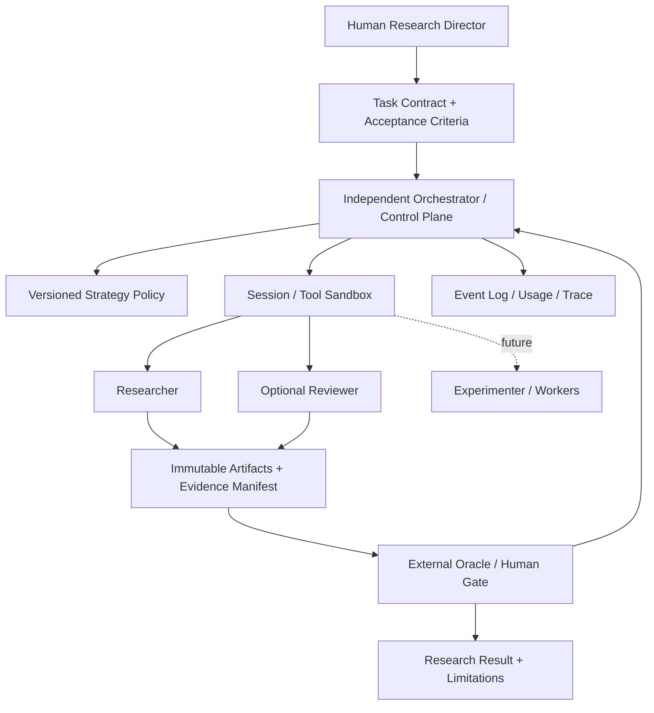

# AI Craft Research OS — Research Team Architecture Whitepaper v0.1

**文件代號：** AIC-ROS-RT-001  
**狀態：** Proposed / Architecture Review Draft（尚未實作或驗證）  
**日期：** 2026-10-19  
**預定路徑：** `AI-Craft-Research-OS/docs/architecture/Research_Team_Architecture_v0.1.md`  
**文件性質：** 設計白皮書、研究協定草案與 Codex 實作前基準；不代表目前系統具有文中所有能力。  
**研究投入：** 約每週 4–6 小時；第一個週期 12 週。  
**語言：** 繁體中文；程式介面、識別符和研究題名可採英文。

> **核心命題：Research Team First; Research the Research Team.** 研究團隊既是完成實驗的工具，也是被實驗檢驗的系統。使用者只需定義目標、品質與全域資源政策；系統負責選擇執行策略，但每一項選擇必須可追溯、可評估、可停止。

---

## 0. 執行摘要與設計決議

1. **開發場所：** 全新、獨立的 `AI-Craft-Research-OS`。`agent-skill-automation` 維持私人歷史參考，不採用其原始碼、Prompt、Skill、Fixture 或資料，不作為 submodule 或執行相依。
2. **獨立 Control Plane：** Orchestrator 是確定性程式控制層，負責狀態、排程、權限、成本、期限、審核閘門、事件追蹤與結果封存。LLM 可以提出計畫、拆解或政策建議，但不能自行突破控制層上限。
3. **Research Team First：** 第一階段用 Researcher 和按需啟動的 Reviewer；Experimenter 先由人工與確定性腳本承擔，未來再升級為可委派角色。
4. **Single Agent First, Multi-Agent Ready：** 第一條可用流程僅需單一 Researcher；第二條增加獨立 Reviewer。角色是邏輯責任，不等於必須分配獨立模型進程。
5. **Policy-driven adaptive orchestration：** 使用者不必決定 Agent 數量、Session 數量、模型版本；由可版本化 Policy 以任務屬性與實驗證據選擇策略。**第一版只有簡單可審核的規則，不宣稱已有自適應最佳化能力。**
6. **Evidence over autonomy：** 所有研究成果均保留題目、資料來源、可執行 Oracle、版本／雜湊、完整 Trial 狀態、成本及人工介入紀錄。
7. **非 BSP 隔離：** 僅以新建、公開、非 BSP／SoC／AOSP 任務與資料進行研究；不從舊私人專案移植內容。
8. **工作量約束：** 前兩週以研究合約與協定為主；之後建立最小可運作路徑。若 12 週不足，縮小實驗規模而非擴建平台。

**本文件的主要交付標準：** 能讓一名獨立工程師依此實作第一個小型 Research Team、透過可客觀評估的任務記錄其行為、比較不同拓樸，並清楚知道哪些能力不在 v0.1 的範圍。

## 1. 研究問題與邊界

### 1.1 研究願景

> Can an independent, evidence-driven control plane select the smallest adequate agent configuration and model capability for a research task—while achieving declared quality requirements under explicit resource and safety constraints?

中文：在任務目標、品質與資源邊界既定的情況下，獨立控制層能否選擇足夠且不過度的 Agent 協作方式與模型能力，使研究成果可信、成本可控，而且使用者不需要手動管理 Session 數量？

**解讀限制：** 「不需要擔心成本」是使用體驗目標，並非無限預算。當硬性 budget 用盡，系統應提供部分成果與證據、明確說明停止原因，必要時要求使用者核准。

### 1.2 首輪可檢驗問題

- **RQ1 / Delegation:** 同一批研究任務，在相同模型、工具、資料與總預算條件下，`Researcher` 單獨完成與 `Researcher → independent Reviewer` 相比，完成品質、錯誤偵測與額外成本有何差異？
- **RQ2 / Policy:** 一個簡單的「依事前任務類別選擇是否審查」規則，能否在混合任務集上達到比固定「全部單 Agent」或「全部雙角色」更好的品質—成本折衷？
- **RQ3 / Reproducibility:** 不同策略是否可以留下足以重跑與稽核的 Task Contract、Trace、輸出與 Oracle？缺漏率是多少？

**明確延後：** 完整 Supervisor + 多 Worker 拓樸、同時平行化、跨模型自動分配、Peer-to-peer Agent Team、策略線上學習。它們是後續擴展方向而非首期必達成果。

### 1.3 假說及反假說

| ID | 待驗證假說 | 合理的反假說／風險 |
|---|---|---|
| H1 | 獨立 Reviewer 對特定容易遺漏證據或推論錯誤的研究任務提高缺陷發現率 | Reviewer 重複同樣錯誤、製造假陽性，或只是增加延遲及 Token |
| H2 | 按任務屬性選擇 Reviewer，優於固定所有任務都啟動 Reviewer | 分類本身不準確，省下的成本少於漏掉錯誤的代價 |
| H3 | 結構化 Handoff 降低跨 Session 資訊遺失與不可審核決策 | Handoff 遺漏關鍵背景，反而增加重工 |
| H4 | 確定性 Control Plane 可以可靠地執行預算、授權與停止條件 | Provider 用量不完整、程序失控或外部 Side Effect 造成政策繞過 |

### 1.4 成功的定義

第一輪成功不是「Multi-Agent 贏」，而是：產生可核查的結果；能報告何時增加 Reviewer 有益、有害或沒有證據；系統能在限制內停止；**即使所有假說被否證，研究仍可成立。**

## 2. 相關研究與設計推導

下表區分**公開來源支持的觀察**及**本專案自己的設計決策**，避免把業界經驗視為普遍定律。

| 文獻／來源 | 已公開的相關觀點 | 對 AI Craft 的推導（本專案設計，不等於來源原文） |
|---|---|---|
| OpenAI Agents SDK — Agent orchestration [R1] | 區分由 LLM 決定 Agent 流程和由程式編排，可混合；Manager-as-tool 與 Handoff 的責任不同 | 保留獨立 Orchestrator，語義計畫是受限的輸入，不是安全與預算最終權威 |
| Anthropic — Building effective agents [R2] | 先用簡單、可組合工作流程；Orchestrator–Workers 與 Evaluator–Optimizer 有不同適用情境，複雜度有成本 | v0.1 拒絕先建通用多代理框架，先建立基準與評估 |
| Anthropic — How we built our multi-agent research system [R3] | 描述 lead agent 與平行研究 subagents 的實務架構及情境 | 納入長期參考，但本研究不預設類似拓樸適合小型任務或受限預算 |
| Cemri et al., *Why Do Multi-Agent LLM Systems Fail?* (2025) [R4] | 多代理系統有規格／設計、Agent 失調、驗證／終止等失敗模式；研究分析五個框架與逾 150 個任務 | 提前定義 Handoff、終止與外部 Oracle，不把 Agent 自我評價當 Ground Truth |
| Anthropic — Demystifying evals for AI agents (2026) [R5] | 區分 task、trial、grader、trace、outcome 與 evaluation harness，強調多次 trial | 讓研究團隊在第一次可用時就保存逐次 trial 與最終環境結果 |
| OpenAI Agents SDK — Tracing [R6] | 提供模型生成、工具呼叫與 Handoff 的追蹤機制 | 定義獨立於 SDK 的最小事件 Schema，特定 SDK Trace 可作輔助 |

**尚未成立的主張：** 本設計未證明自動路由節省費用，也未證明 Multi-Agent 在我們自建任務集上有統計顯著優勢。所有預期效益在實驗前均屬假說。

## 3. 現有 Repository 調查的採納範圍

本章依 2026-10-19 由 Codex 產出的 `Architecture_Discovery_Report.md` 與 `AI_Craft_Reuse_Decision.md`；這兩份是**本地靜態程式觀察的二手調查報告**，不是舊程式實際成功運轉的實驗證據。

### 3.1 已被報告觀察到的部分

- `closed_loop.sh` 的生成、驗證、最佳化、安全檢查與部署狀態機，以及呼叫 Claude CLI 的路徑。
- `.claude/skills/`、`.claude/agents/` 的定義檔及日常 CLI 研究流程。
- JSONL session log、部分評估器、重試與 timeout、權限靜態檢查及生命周期資訊。

### 3.2 不可推論或不能直接繼承

- 不能把 Agent Markdown 定義視為自建 agent runtime；Phase 5 多代理協作在文件中仍標 Pending。
- 部分 async eval 只以 trigger pattern 判定，不能代替研究品質 Oracle；報告未執行舊測試，也未查驗歷史宣稱的成功率。
- 某些舊路徑使用 `--dangerously-skip-permissions`；**新系統不得將此行為當成自動化預設。**
- 來源、授權與 Git History 未完整審核；不可複製舊實作、prompt、研究資料、fixture 或敏感路徑內容。

**採納決議：** `REVISIT`。唯一可直接承接的是通用工程問題與抽象經驗，例如：明確任務合約、最小權限、實驗記錄、可重現測試的必要性。所有新 Schema／程式從乾淨原始檔獨立編寫。

## 4. 系統架構

### 4.1 邏輯與信任邊界



**邊界規則：** Agent 回傳的 plan、tool request 或 self-score 皆為資料；只有 Control Plane 可以核准開始、切換、重試、提升資源與停止。外部工具的副作用不能因某個 Agent 宣稱「已獲核准」而放行。

### 4.2 各層職責

| 層 | 負責 | 不負責 |
|---|---|---|
| Human Research Director | 選題、範圍、重大政策、公開與最終結論 | 日常手動指定 Agent 數量 |
| Control Plane | 執行狀態、策略、硬限制、工具與檔案權限、checkpoint、記錄 | 以 LLM 自由文字取代可核查政策 |
| Semantic Agents | 找來源、分析證據、產生報告與指出風險 | 自行批准資源超支、修改 Oracle 或發布研究結論 |
| Evidence Plane | Versioned inputs、artifacts、event logs、用量、雜湊、Git SHA | 自行生成正確性結論 |
| Oracle & Human Gate | 外部客觀檢查、依標準執行人工裁決 | 因為偏愛某架構而重新調整及格線 |

### 4.3 模組介面（概念 API，非已存在程式）

```text
TaskContract -> Policy.select_strategy(task, budget, capabilities)
PolicyDecision -> Controller.execute(session_spec)
AgentExecution -> ArtifactManifest + UsageRecord + TraceEvents
ArtifactManifest -> Oracle.evaluate(task, artifacts)
OracleResult -> Controller.finish_or_escalate()
```

每個 `PolicyDecision` 必須有 `policy_version`, `reason_code`, `inputs_digest`, `strategy_id` 和 `budget_snapshot`。要支援「研究政策」就不能只保留最終選到的 Agent 名稱。

### 4.4 Agent 不等於 Session，不等於 Model

- **Role：** Researcher、Reviewer、Experimenter 的職責及輸出合約。
- **Agent instance：** 執行 Role 的一次具體實例。
- **Session：** 上下文與生命週期的執行容器，可由 CLI 或 API 持有。
- **Model：** Agent instance 使用的推理模型。
- **Topology：** Agent/Session 的控制與資訊流拓樸。
- **Skill：** 可重複使用的指令或知識資產；本身並不表示有另一個 Agent 執行。

此區分使同一個 Researcher Role 可以由單 Session、跨 Session 或日後不同模型執行，而不必先選框架。

## 5. Research Team Charter

### 5.1 人類研究負責人（Human Research Director）

接受研究題目、簽核風險與公開內容、設定研究品質與資源政策。對所有外部發布、授權、可造成 Side Effect 的敏感操作保留最終決策權。

### 5.2 Researcher（v0.1 必要）

**輸入：** 問題、資料/工具 allowlist、預期交付、來源需求、時間與費用上限。  
**輸出：** `research_note.md`、`claims.json`、`sources.json`、`uncertainties.md`。  
**必須：** 將結論區分為已觀察／推論／假說；每項可檢驗重要 Claim 對應具體 Evidence ID；承認未知；無法查證時不填補。  
**不得：** 自行修改 Task Contract、Oracle 或 Policy；私自啟用搜尋、執行或外部連線。

### 5.3 Reviewer（v0.1 按需）

**輸入：** 原 Task Contract、Researcher 產物、相同允許來源（並可接受盲化的策略資訊）。  
**輸出：** `review_findings.json`、`review_summary.md`，逐項標記 claim_id、evidence_ref、severity、可重現檢查與修正建議。  
**責任：** 反證、引用是否支持主張、遺漏前提、規格違反與不確定性。  
**不得：** 自己宣告研究成功，或用無法外部查證的直覺替代 Oracle；不得自行增加重審次數。

### 5.4 Experimenter（延後；第一版人工／腳本）

**未來責任：** 按已簽核協定建立隔離 Trial、執行固定測試、收集成本與結果。  
**先期替代：** 由 Control Plane 呼叫確定性測試程式；必要時由使用者手動啟動，避免自動代理操作系統的擴權。

### 5.5 Curator／Synthesis Agent（延後）

整理公開研究包與教學輸出；須於有足夠研究成果及維護需求時才增加，不能把產出媒體視為研究品質證據。

## 6. Workflow、狀態機與 Handoff

### 6.1 最小狀態機

```text
DRAFT -> APPROVED -> QUEUED -> RUNNING -> REVIEW_PENDING? -> EVALUATING
        -> [SUCCEEDED | FAILED | PARTIAL | BUDGET_STOP | HUMAN_HOLD]
```

每個變更都附 `event_id`、`timestamp_utc`、`task_id`、`run_id`、`actor`、`previous_state`、`next_state`、`policy_version`、`reason_code`。重試是新 Trial 或明確子事件，不能蓋掉原紀錄。`APPROVED` 是 Task 確認；`HUMAN_HOLD` 是外部批准閘門。

### 6.2 v0.1 支援的三條路徑

- **P0 — Single:** Task → Researcher → External Oracle → Output。
- **P1 — Review-all:** Task → Researcher → independent Reviewer → External Oracle → Output。
- **P2 — Selective Review（研究用規則）：** Task → 事前預註冊 Policy → P0 或 P1 → Oracle。

策略 P2 不得讀取答案或 Oracle 結果才事後決定「早知道應該加 Reviewer」；如果容許基於執行進度再委派，須另立實驗協定並記錄可見訊號。

### 6.3 Handoff 最小欄位

```yaml
schema_version: "0.1"
handoff_id: "H-0001"
origin_run_id: "R-0001"
from_role: researcher
to_role: reviewer
task_id: "T-0001"
objective: "Audit the evidence of the research note"
artifact_refs: ["artifacts/R-0001/research_note.md"]
artifact_sha256: {}
source_allowlist_refs: ["public-corpus-v1"]
constraints:
  no_external_writes: true
  no_new_sources_without_approval: true
expected_outputs: ["review_findings.json", "review_summary.md"]
status: pending
```

Handoff 應以最小充分內容交接：既要有任務背景，又避免將整段前一 Session 的隱含推理及大量不相關內容直接複製進去。若原證據不足，Reviewer 應回報「無法驗證」，而不是自行推斷。

## 7. Policy 與模型路由演進

### 7.1 「使用者不用選 Agent」的可執行定義

使用者輸入 `goal`、`acceptance`、`permissions`、`resource_profile`；系統輸出所選 `strategy_id` 及理由。初期的 `resource_profile` 可使用 Economy／Balanced／Quality First，但一定有硬上限與模型 allowlist。真正的使用者體驗不是零設定，而是**一次設定資源與安全政策，日常任務免手動編排**。

### 7.2 初期 Policy 範例（僅示意，待校準）

```python
# Conceptual pseudocode; NOT production implementation.
def choose_strategy(task, policy):
    if task.requires_human_approval:
        return "HUMAN_HOLD"
    if task.type in policy.review_required_task_types:
        return "P1_RESEARCHER_REVIEWER"
    return "P0_SINGLE_RESEARCHER"
```

初期只依**執行前可見且可重現**的任務分類，避免把估計準確率視為已存在的模型能力。所有 Policy 更新需 version bump 和新的評估批次。

### 7.3 後續研究階段

1. **靜態模型（首期）：** 所有策略使用同一固定 provider、model ID 與相同工具權限，以分離 topology 的影響。
2. **受控模型路由：** 在固定拓樸下，測試較低成本模型與升級模型的品質／失敗成本，建立經驗表。
3. **聯合決策：** 將模型選擇、拓樸、依賴關係、可平行程度與 budget 聯合優化；需先有足夠 task/trial 数据，不能從少量主觀案例推導。
4. **同儕／跨平台通訊：** 只有當 explicit handoff 無法滿足經驗性需求，才考慮 message bus／Peer collaboration。

### 7.4 決策目標

最小化預期的總資源負擔，同時達成最低品質與權限約束；評估應報告多目標 Pareto 前緣，不能只以一個不透明綜合分數宣告「最好」。

```text
Choose strategy π to improve:
  task_success, factual_accuracy, trace_completeness
while reducing:
  total_cost, wall_clock_latency, human_effort, severe_failure_rate
subject to:
  hard_budget, time_limit, permission_policy, approved_inputs
```

## 8. Evidence Plane 與 Schema

### 8.1 Task Contract 範例

```yaml
schema_version: "0.1"
task_id: "T-0001"
title: "Check claims against frozen public documentation"
domain: "general-python-tooling"
objective: "Produce an evidence-backed research note"
inputs:
  corpus_id: "public-docs-frozen-v1"
  corpus_sha256: "<sha256>"
  task_fixture_ref: "tasks/T-0001/input.md"
acceptance:
  oracle_id: "citation-and-fact-check-v1"
  required_artifacts: ["research_note.md", "claims.json", "sources.json"]
permissions:
  network: false
  filesystem_write_scope: "runs/<run_id>/artifacts"
  executable_allowlist: []
resource_policy:
  profile: balanced
  max_total_cost_usd: 1.00 # example only; approval required
  max_wall_seconds: 900    # example only
  max_trials: 1
human_gates: ["publish"]
```

### 8.2 Trial Record（所有狀態均保留）

```yaml
schema_version: "0.1"
experiment_id: "EXP-001"
task_id: "T-0001"
trial_id: "TR-0001"
strategy_id: "P0_SINGLE_RESEARCHER"
policy_version: "0.1.0"
ordered_execution: 1
started_at_utc: "<iso8601>"
finished_at_utc: "<iso8601>"
status: "SUCCEEDED"  # or FAILED, SKIPPED, TIMEOUT, RATE_LIMIT, BUDGET_STOP...
code_git_sha: "<sha>"
model:
  provider: "<provider>"
  id: "<model-id-or-snapshot>"
  parameters: {}
inputs_hashes: {}
prompt_hashes: {}
tool_permissions_hash: "<sha256>"
environment_id: "<container-or-lockfile-id>"
usage:
  input_tokens: null
  output_tokens: null
  reported_cost_usd: null
  estimated_cost_usd: null
  wall_seconds: null
  provider_usage_available: false
human_interventions: []
artifacts: []
oracle:
  version: "citation-and-fact-check-v1"
  result: null
failure_reason: null
```

**成本資料原則：** 保留 Provider 原始 usage、估算費用與計價版本；分別列出不能取得的欄位，不能把未知值記作 0；所有 Agent Session 消耗合併成 task total。CLI 訂閱額度不一定等於逐次 API 成本，須明示計價制度。

### 8.3 Trace & Artifact

- 事件以 append-only JSONL 儲存；含每個 session 開始、工具呼叫、artifact 發布、review、oracle、停止與人類介入。
- 用內容 SHA-256 與 manifest 連接 artifacts；保存 Prompt 和環境必要快照或其可核查版本。
- 禁止寫入 Token、API Key、私人對話、未授權資料、公司資料；原始輸出公開前必須做資料最小化與人工審查。
- Trace 是過程證據，不等同於成功 Oracle；成功判定以最終可驗證結果優先。

## 9. Research Team 作為自我研究對象

### 9.1 評估設計

**第一個研究用資料集（建議草案）：** 以全新、公開、非 BSP 的凍結文件和一般 Python 工具任務建構 6–10 個可客觀評分的小任務；至少涵蓋：

1. **事實核查型：** 從固定公開文件判斷具備標準答案的技術敘述是否成立，回傳來源定位。
2. **證據整合型：** 比較兩份公開規格／文件中的特定差異，預定 required claims 和 forbidden unsupported claims。
3. **小型工程研究型：** 檢查 Python CLI 專案的可重現行為，提供 pytest 結果與簡短原因分析。

初期「研究品質」無法全靠 pytest；因此必須組合 deterministic checks（必要產物、引用可定位、事實題答案、測試結果）和預先寫好的人工 rubric。不可直接由 Reviewer 的感覺給成功分數。

### 9.2 主要結果變數

| 指標 | 定義 |
|---|---|
| Task success | 依固定 Oracle 的完整通過率；另列各項分數 |
| Factual / citation accuracy | 抽查 claims 是否為指定公開證據支持；引用是否可定位 |
| Critical error detection | Reviewer 真正找出的預植／已知重大錯誤，及 false positives |
| Cost | 全 Session API 或等效估計成本，完整註明來源和缺值 |
| Wall-clock | 從 Runner 開始到產出最終交付的實際時間；區分順序與平行 |
| Human effort | 人工補充、修正、批准、審查分鐘數 |
| Trace completeness | 必填事件與欄位完整率、Artifact Hash 通過率 |
| Failure modes | 按失敗 taxonomy 分類：規格、協調、驗證／終止等 |

### 9.3 因果比較控制

- 首輪固定 model/provider/model snapshot、Prompt 版本、知識資料及工具／網路政策、執行環境、總 Token／費用／時間上限。
- 多 Session 的 Worker/Reviewer 消耗**全部計入總預算**；baseline 也可使用可比較的總上限，不保證兩組實際 token 完全相同。
- 同一任務多次 Trial；用交錯或隨機順序避免時間段／服務狀態差異。保留失敗、SKIP、TIMEOUT、RATE_LIMIT。
- 先凍結 Task／Oracle，再執行；用于 Policy 設計的任務與最終驗證集分離。
- 若人工評分可能受架構認知影響，隱藏輸出來源；記錄無法盲化的情況。
- 初始 6–10 個任務只屬**可行性 Pilot**，樣本過小不得做一般化或宣稱統計顯著改進。
- 測試成本需要真實 Token/費用上限；如無法取得逐次用量，明示局限，不作跨模式的成本效益結論。

### 9.4 評估自我研究的循環依賴

Researcher 與 Reviewer 可以檢查產物，但不可獨占定義或調整評分規則。Oracle 與驗收資料由外部預先確定；研究負責人定期稽核已完成 Trial；如改了 Oracle，須新增版本並標明舊結果不直接可比。Reviewer 所提建議是**候選修正**，不是自動升級政策的事實依據。

### 9.5 報告格式

每次公開報告最少應有：研究問題／事前假說、Task Set、模型與工具、預算、完整結果表（含失敗）、效果差異與不確定性、已知偏差／外部效度限制、可重現指令、Git SHA、資料授權與後續研究提案。

## 10. Security、Provenance 與人類審核

- **公司隔離：** 僅使用私人時間、私人設備、個人帳號、獨立資料。避免 BSP／SoC／AOSP 的產品、程式、Prompt 與領域資料進入本研究。
- **新作產權：** 全新獨立實作；不從舊 Repo Copy-Paste 或以私人歷史紀錄作公開資料；記錄新檔案來源與依賴授權。
- **工具權限：** 預設唯讀、網路關閉、受限目錄、禁用危險權限略過旗標；外部執行、套件安裝與網路發送需獨立政策核准。
- **資料輸入屬不可信：** 網頁、文件、GitHub issue、工具回傳均不能提升權限或覆寫 Task Contract；對 Prompt Injection 有阻擋與事件記錄。
- **執行隔離：** 可使用容器或可驗證的受限工作目錄；不使用主機全域工作樹作 Agent 無限制沙盒。
- **網路與秘密：** API Key 從安全環境提供但不寫入 trace；設定域名 allowlist／禁用傳出路徑；避免將研究資料自動送至未經批准的第三方追蹤服務。
- **審批閘門：** 任何公開 push、發佈、付費服務、不可逆檔案操作、超出預算、存取非公開資料都需人類確認。
- **透明失敗：** Controller 無法驗證權限與成本就停止或降級，不能讓 Agent 自行解釋已經安全。

## 11. 分階段工程計畫

### Phase 0 — Docs & Protocol（W01–W02）

**輸出：** 本白皮書、ADR-001、Research Team Charter、Research Question Brief 001、Task Contract Schema、初步 Policy、Oracle 草案。  
**禁止：** 啟動自動研究排程、開發通用 Agent Framework、實作多模型路由。  
**退出條件：** 人類通過研究問題與資料／IP 邊界；至少 2 個可人工執行的 Task + Oracle 範例；每個欄位可明確解釋。

### Phase 1 — L0 Single-Agent Research Path（W03–W04）

**輸出：** 一條 Researcher 執行路徑（CLI 或最小 API 封裝）、隔離目錄、輸出 Artifact、JSONL Trial Log、固定 Oracle。  
**退出條件：** 至少 2 個公開任務可執行並完整記錄；硬性 timeout 有效；失敗也可重現；無危險權限預設。  
**可接受縮減：** 起初用人工命令與小型 Script；不強制抽象化 provider adapters。

### Phase 2 — Reviewer + Explicit Handoff（W05–W06）

**輸出：** `P1` Review 路徑、Handoff Manifest、分離 Session、整合成本記錄。  
**退出條件：** Reviewer 接收的是可審核輸入、不能改 Task/Oracle、輸出找得到證據；失敗有明確狀態與停止原因。

### Phase 3 — Pilot Evaluation（W07–W08）

**輸出：** 小型固定任務集上的 P0/P1 trial、首次失敗模式分析；可包括政策檢查。  
**退出條件：** 所有 Trial（含失敗）完整紀錄；分析未混淆使用量、延遲與品質；完成一次協定審查。  
**注意：** W08 可當 deload/review 週，不追求跑更多昂貴實驗。

### Phase 4 — Static Adaptive Policy（W09–W10）

**輸出：** 依事前任務類別選用 P0/P1 的 `P2` Policy；以留出任務評估。  
**退出條件：** `reason_code` 可稽核；同一份 Contract 和 Policy 版本可重跑；顯示品質／費用／延遲 trade-off，即使 P2 沒有改善也照實記錄。

### Phase 5 — Synthesis & Release Candidate（W11–W12）

**輸出：** Pilot Research Report、限制與失敗案例、ADR 修訂、下輪提案與可公開資產審查。  
**退出條件：** 公開報告不宣稱未證實的因果效益；所有公開資料來源與授權可查核；人工簽核發布。

### 超出工時時的降級策略

在 12 週只剩少量時間時，按順序保留：（1）可重現單 Agent，（2）客觀 Oracle，（3）明確 Handoff／Reviewer，（4）比較結果；最先延後 Policy 自動切換、第二模型、並行及 UI。整個週期以研究品質為優先，不為滿足架構圖而追加未經驗證功能。

## 12. 每週訓練節奏與投入量

**正常週 5 小時參考：** 60 分鐘閱讀及問題定義、90 分鐘主要實驗／實作、120 分鐘長時段深度工作、30 分鐘實驗紀錄與週回顧。每三週推進一週減量或整頓；忙碌週保留最低 90 分鐘研究與 30 分鐘紀錄；非常忙的週可只保留研究記錄，不補追積欠時數。

| 週 | 主訓練 | 本週交付 |
|---|---|---|
| W01 | 建立 Charter、拆清首題 | RQ Brief 001、白皮書審閱註記 |
| W02 | 定義 Oracle、Policy 與測試資料 | Protocol 001、2 個 Fixture |
| W03 | L0 Runner／手動 Session | 可重現的單次 Researcher Run |
| W04 | Trace 與停止條件 | 單 Agent 基準 Ready；減量回顧 |
| W05 | Reviewer 角色與輸出契約 | Reviewer Prompt v0.1／Schema |
| W06 | 明確 Handoff | 雙 Session 可追蹤執行 |
| W07 | P0/P1 小型比較 | Pilot Trial Logs |
| W08 | 校驗資料與 Review | Oracle/Trace 缺口修正；減量週 |
| W09 | 靜態 Policy | P2 Version 0.1 |
| W10 | 留出樣本評估 | Policy Comparison Data |
| W11 | 研究報告 | Draft Research Report |
| W12 | Publication Review | Evidence Pack、下一週期路線；減量週 |

## 13. Architecture Decision Records (ADR)

### ADR-001 — Independent Research OS Repository
- **決定：** `AI-Craft-Research-OS` 為唯一主要研究／開發所在地；`agent-skill-automation` 維持 Private，限抽象經驗參考。
- **理由：** 原系統以 Claude CLI 與部分未驗證 Prompt/Phase 5 設計為主，原始碼來源及敏感領域邊界尚未核實。
- **代價：** 需重新建立最小 Schema 和執行程式；換取乾淨的來源界線與可控研究變因。
- **重訪條件：** 有具體被證明必要的通用 helper，且完成來源、授權、安全檢查。

### ADR-002 — Deterministic Independent Orchestrator
- **決定：** 檔案、預算、權限、狀態與終止由程式控制；模型作為受約束的語義工作者。
- **理由：** 提高可追溯性、控制重試及成本，避免模型自核准。
- **代價：** 多一層程式契約與狀態處理；可在 v0.1 保持極薄。

### ADR-003 — Research Team as Experimental Subject
- **決定：** 系統預留 P0/P1/P2 路徑及獨立 Oracle；系統自評不是 Ground Truth。
- **理由：** 每次架構升級都須被證據支持。
- **代價：** 初期須投入 Task/Oracle/Logging，而非先追求功能展示。

### ADR-004 — Static Policy before Learned Routing
- **決定：** 初期同模型與受限規則；在足夠樣本前不加入動態模型選擇及強化式決策。
- **理由：** 避免一次改變拓樸與模型，導致不可歸因。
- **重訪條件：** 具有穩定 baseline、足夠 trial、可比成本紀錄、已分離 validation set。

## 14. 主要風險與緩解

| 風險 | 危害 | 緩解 |
|---|---|---|
| 用 Agent Judge 當唯一 Oracle | 自評偏差、虛假成功 | 確定性測試、封存答案、人工盲評 |
| Prompt/Oracle 在同一題反覆修改 | Overfitting、結果樂觀 | 版本化與凍結任務、分離研究與留出集 |
| Multi-Agent 額外可用 Token | 不公平比較 | 同等硬性資源上限、完整記錄所有 Session |
| Provider 模型／定價變化 | 無法直接跨期比較 | Snapshot、日期、計價版本、固定批次 |
| Prompt Injection／越權工具 | 資料外洩／不當寫入 | 獨立權限層、沙盒、人工 gate |
| 未知成本或使用量 | 不能判定 ROI | 缺值明示、估算分離、上限停止 |
| 平行與拓樸同時改變 | 效果不可歸因 | 第一輪按順序執行；平行另立實驗 |
| 樣本數太小 | 過度概括 | 標記 Pilot，呈現個別 case 和不確定性 |
| 公開材料/IP 邊界不清 | 職業與來源風險 | 全新公開非 BSP 任務、clean-room 實作 |
| 每週時間不足 | Overengineering、研究中斷 | Phase gates、可降級計畫、deload |

## 15. Codex 執行指示／移交條件

**第一個 Codex 任務只能是文件整合與缺口分析，不直接實作 Orchestrator。**

1. 將本白皮書放入 `docs/architecture/Research_Team_Architecture_v0.1.md`，保留版號。
2. 若 `AI-Craft-Research-OS` 已有 README、Roadmap、Concept 001、ADR 等文件，**先檢查衝突並回報**；不可直接覆寫既有決議。
3. 建議但不自動建立以下文件：
   - `docs/decisions/ADR-001-independent-research-os.md`
   - `docs/research/Research_Question_001.md`
   - `docs/research/Experiment_Protocol_001.md`
   - `docs/architecture/Research_Team_Charter_v0.1.md`
4. 請輸出 `DOC_INTEGRATION_REVIEW.md`：列出已有章節重疊、未確定 Schema 欄位、風險、可切成 30–90 分鐘的小任務、第一週建議下一步。
5. 避免引入老專案程式碼／資料／Prompt，避免 BSP／SoC／AOSP 領域測試。
6. 不呼叫外部 API、不執行 Agent、不建立資料庫、不部署、不推送 GitHub。任何建立公開遠端 Repository、push 或發佈須由使用者另行核准。

**文件審閱 Gate：** Owner 審定 RQ、Oracle、資料、IP 邊界與每週預算後，才批准 Phase 1 的最小程式工作。

## 16. 尚待研究負責人核定的問題

1. 第一個 Pilot 應以「公開技術文件的證據核查」還是「小型 Python 工程調查」作為主場景？建議選前者以讓 Oracle 更容易凍結，另保留兩個 Python Task 測外部效度。
2. 是否將外部網路存取全部關閉並使用 frozen corpus，作為首輪公平性與可重現性基準？建議是。
3. 一個 Session 最多可用多少 Token／等效 API 成本及執行時間？本白皮書內所有金額只是 Schema 示例，非實際預算批准。
4. 第一階段研究可用哪一種 Provider／模型，且能否取得逐次用量？需在 W02 freeze。
5. 是否要將第一期 Pilot 的完整 Trace 公開，或只公開經核查的匿名／去識別事件與 artifacts？建議後者。

## 17. 參考來源與查核範圍

### 公開資料（2026-10-19 查核）

- **[R1]** OpenAI, *Agent orchestration*, Agents SDK. https://openai.github.io/openai-agents-python/multi_agent/ — 官方 SDK 設計與兩種 Orchestration 決策方式。
- **[R2]** Anthropic, *Building effective agents* (2024). https://www.anthropic.com/engineering/building-effective-agents — 產業工程經驗、簡潔架構與工作流程模式。
- **[R3]** Anthropic, *How we built our multi-agent research system* (2025). https://www.anthropic.com/engineering/multi-agent-research-system — 特定研究系統實例；不代表對所有工作負載普遍有利。
- **[R4]** Cemri et al., *Why Do Multi-Agent LLM Systems Fail?* (2025), arXiv:2503.13657. https://arxiv.org/abs/2503.13657 — 失敗分類研究；未從本文推導本平台預期增益數字。
- **[R5]** Anthropic, *Demystifying evals for AI agents* (2026). https://www.anthropic.com/engineering/demystifying-evals-for-ai-agents — Task、Trial、Trace、Outcome、Grader 與評估 Harness 概念。
- **[R6]** OpenAI, *Tracing*, Agents SDK. https://openai.github.io/openai-agents-python/tracing/ — SDK 觀測能力；本研究之 Trace Schema 仍獨立定義。
- **[R7]** OpenAI, *Orchestration and handoffs*, API Docs. https://developers.openai.com/api/docs/guides/agents/orchestration — Manager/Handoff 選擇與何時增加 Specialist。

### 專案既有調查（使用者提供，未獨立重跑）

- **[I1]** `Architecture_Discovery_Report.md`，Codex 靜態調查：記錄舊 Repository 的已觀察程式、文件宣稱、未證明能力、安全與評估缺口。
- **[I2]** `AI_Craft_Reuse_Decision.md`，Codex 建議：`REVISIT`，新建薄型研究路徑、抽象概念獨立實作、拒絕直接移植舊內容。

### 證據狀態標籤

- **Observed in prior audit：** 僅指 Codex 靜態調查報告觀察到的程式碼路徑；本文件未執行舊系統。
- **Published evidence：** 指上述外部原始資料或論文的具體主張；可引用但不視為本系統實驗結果。
- **Proposed：** 本白皮書架構、Schema、路線與評估計畫，尚待主人審批及實作。
- **Unverified：** 舊系統歷史績效、新架構經濟性、Adaptive Policy 成效和跨模型效益。

---

**版本規範：** v0.1 為研究負責人審查稿。任何已批准的 Schema、Oracle、Policy 或拓樸變更必須加註版本和理由，避免事後以新規則重新詮釋舊 Trial。未取得研究負責人核准前，本文不得作為可自行啟動代理、對外發布或動用額外資源的授權。
